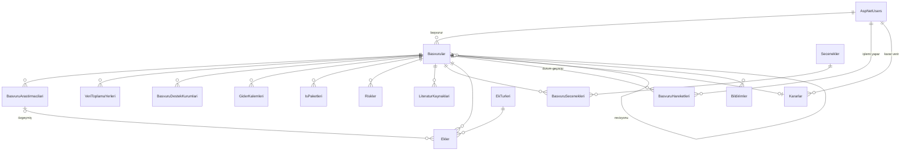

# Veritabanı Tasarımı

Kaynak: Selçuk Üniversitesi Teknoloji Fakültesi "Etik Kurul Başvuru Formu", Dilekçe, Ek-1 Taahhütname, Ek-2 Gönüllü Katılım Formu.

Kod karşılıkları: `src/EtikKurul.Api/Entities` (tablolar), `Data/Yapilandirmalar.cs` (ilişkiler), `Data/SabitVeriler.cs` (başlangıç verileri).

## Tasarım kararları

1. **Formun tek değerli alanları `Basvurular` tablosunda**, formda "satırlar çoğaltılabilir" denen her bölüm ayrı tabloda (1-N).
2. **Çoklu seçimler** (veri toplama aracı, katılımcı grupları, uygulamalar) sabit `Secenekler` tablosu + `BasvuruSecenekleri` ara tablosu (N-N). Böylece "kaç başvuruda çocuk katılımcı var?" tek sorguyla bulunur.
3. **Enum alanlar metin olarak saklanır** (`Durum = 'Dekanlikta'`), SSMS'te okunabilir.
4. **Durum geçmişi silinmez**: her geçiş `BasvuruHareketleri`ne satır olarak eklenir. "Evrak nerede?" ekranı buradan oluşur.
5. **Dosyalar veritabanında değil diskte**; `Ekler` tablosu yalnızca bilgisini ve tahmin edilemez dosya adını tutar.
6. **Ek zorunlulukları veriyle tanımlı** (`EkTurleri.ZorunlulukKurali`), kural kodda uygulanır.
7. **Eşzamanlılık**: `Basvurular.SatirVersiyonu` (rowversion). İki yetkili aynı başvuruyu aynı anda işleyemez.
8. **Kullanıcılar silinmez, pasif yapılır**; kullanıcıya bağlı kayıtlar `Restrict` ile korunur.

## İlişki diyagramı



## Tablolar

| Tablo | Ne tutar | Formdaki karşılığı |
|---|---|---|
| **AspNetUsers** (`Kullanici`) | Ad, soyad, birim, e-posta, kurumsal e-posta, telefon, adres, aktiflik | Kullanıcı kaydı |
| **AspNetRoles / AspNetUserRoles** | Basvuran, EvrakKayit, Dekanlik, EtikKurul, Admin | Yetkilendirme |
| **Basvurular** | Durum, wizard adımı, kilit, evrak kayıt no/tarihi, genel bilgiler, özetler, amaç, yöntem, özgün değer, yaygın etki, etik sorular (9–16) | Formun tek değerli alanları |
| **BasvuruArastirmacilari** | Rol, unvan, ad soyad, telefon, e-posta, görev yeri | Sorumlu araştırmacı + ekip |
| **VeriToplamaYerleri** | Yer/kurum adı | "Veri toplanması planlanan yerler" |
| **BasvuruDestekKurumlari** | Destekleyen / planlanan, kurum türü, açıklama | Destekleyen kurumlar (satır yoksa "Yoktur") |
| **GiderKalemleri** | Tür, açıklama, tutar | Araştırma giderleri |
| **IsPaketleri** | No, ad, kimler, süre | 7. Yönetim düzeni |
| **Riskler** | İP no, risk, B planı | 8. Risk yönetimi |
| **LiteraturKaynaklari** | Tür (seçilmiş/yöntem), kaynak | Literatür listeleri |
| **Secenekler** | Grup, ad, "Diğer" mi, çocuk rızası gerektirir mi | Çoklu seçim kutuları (sabit) |
| **BasvuruSecenekleri** | Başvuru ↔ seçenek | İşaretlenen kutular |
| **EkTurleri** | Kod, ad, zorunluluk kuralı, çoklu dosya, sistem üretir mi | Dilekçe, Başvuru Formu, Ek-1…Ek-11 (sabit) |
| **Ekler** | Ek türü, araştırmacı (özgeçmişse), dosya adları, boyut, yükleyen, tarih | Yüklenen ıslak imzalı PDF'ler |
| **BasvuruHareketleri** | Önceki/yeni durum, işlemi yapan, tarih, açıklama | "Evrak nerede?" |
| **Kararlar** | Karar no, tarih, tür, gerekçe, veren, QR doğrulama kodu, karar PDF'i | Kurul kararı |
| **Bildirimler** | Alıcı, konu, içerik, gönderildi mi, hata | E-posta kayıtları |

## Başvuru durumları

```
Taslak → ImzaliBelgeBekleniyor → EvrakKayitta → Dekanlikta → EtikKurulda
       → KararDekanlikta → Sonuclandi → Arsivlendi
                  ↘ IadeEdildi (eksik belge) → Taslak
```

## Ek zorunluluk kuralları

| Ek | Kural |
|---|---|
| Dilekçe, Başvuru Formu, Ek-1, Ek-2 | Her zaman (sistem doldurulmuş PDF üretir) |
| Ek-3 Çocuk Rıza Formu | Soru 12 "Evet" veya 18 yaş altı katılımcı grubu seçildiyse |
| Ek-4 Destekleyen kuruluş protokolü | Destekleyen kurum varsa |
| Ek-5 Broşür, proforma | İsteğe bağlı |
| Ek-6 Tez onayı + öğrenci belgesi | Nitelik bir tez türüyse |
| Ek-7 Özgeçmiş | Her araştırmacı için bir dosya |
| Ek-8 Flash bellek | Kullanılmıyor (elektronik sistem) |
| Ek-9 Proje örneği | BAP veya tez ise |
| Ek-10 Veri toplama araçları | Anket/görüşme/ölçek seçildiyse |
| Ek-11 Kullanım izni | Veri toplama aracı başkasına aitse |

## Hocayla teyit edilecekler

- Karar türleri: Uygun / Uygun Değil / **Düzeltme İstenir** var mı?
- Ek-8 (flash bellek) elektronik sistemde kaldırılabilir mi?
- Evrak kayıt numarasının biçimi (ör. `2026/0042`)?
